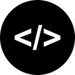

<h1 align="center">Hassan Jamshaid</h1>

  BS Robotics student · Embedded systems, AI/ML and full-stack developer

  
  
  
  
  

## About

I'm a BS Robotics student who builds practical software and hardware. I work across robotics and embedded systems (Arduino, Raspberry Pi), AI/ML and full-stack web development. I like turning ideas into working projects, from a speed radar system and an obstacle-avoiding robot car to a skin lesion classifier with explainable heatmaps and a finance web app. I'm currently learning cloud and DevOps (AWS, Docker), and I'm open to internships, open-source contributions and collaboration.

## Tech Stack

**Robotics and embedded systems**

  
  
  
  

Sensor interfacing, motor control, circuit prototyping and robotics fundamentals.

**Web development**

  
  
  
  
  
  
  
  
  
  

**AI, machine learning and data science**

  
  
  
  
  
  
  
  

**Programming and tools**

  
  
  
  
  

**Currently learning**

  
  

## Featured Projects

<table>
  <tr>
    <td width="50%" valign="top">
      <h3>Obstacle-Avoiding Robot Car</h3>
      
A two-wheel robot car that detects obstacles in its path and steers around them on its own.

      <ul>
        <li>Sensor-based obstacle detection</li>
        <li>Automatic motor control for turning</li>
      </ul>
      

        
        
      

      

    </td>
    <td width="50%" valign="top">
      <h3>Speed Radar System</h3>
      
A speed radar system that measures how fast an object is moving and displays the reading.

      <ul>
        <li>Real-time speed measurement</li>
        <li>Live output of the measured speed</li>
      </ul>
      

        
        
      

      

    </td>
  </tr>
  <tr>
    <td width="50%" valign="top">
      <h3>Lesion Lens: Skin Lesion Classifier</h3>
      
An AI web app that classifies skin lesion photos into nine types and shows what influenced each prediction.

      <ul>
        <li>Grad-CAM heatmaps for every prediction</li>
        <li>Batch upload with CSV and report export</li>
      </ul>
      

        
        
        
      

      
&nbsp;&nbsp;

    </td>
    <td width="50%" valign="top">
      <h3>Vanguard Finance AI</h3>
      
An expense log you talk to that files the amount, sorts the category and reports what is left of your limit.

      <ul>
        <li>Log expenses by WhatsApp message or in the web app</li>
        <li>Monthly limits per category</li>
      </ul>
      

        
        
        
      

      
&nbsp;&nbsp;

    </td>
  </tr>
</table>

### Other projects

- [OpenSmash Web](https://github.com/hassanj-dev/opensmash-web)
- [Shopping Mart System](https://github.com/hassanj-dev/Shopping-Mart-System)

  

## Activity

  <picture>
    <source media="(prefers-color-scheme: dark)" srcset="https://raw.githubusercontent.com/hassanj-dev/hassanj-dev/output/github-snake-dark.svg" />
    <source media="(prefers-color-scheme: light)" srcset="https://raw.githubusercontent.com/hassanj-dev/hassanj-dev/output/github-snake.svg" />
    
  </picture>

## Get in Touch

I'm looking for internship opportunities in robotics, AI/ML and software development, and I'm happy to collaborate on open-source projects. The best way to reach me is by [email](mailto:hassanjss27@gmail.com) or on [LinkedIn](https://www.linkedin.com/in/hassan-jamshaid/).
